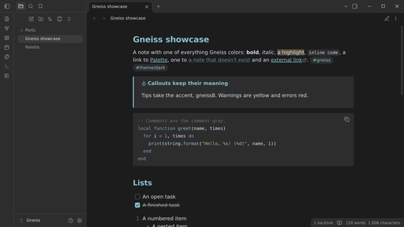

# Gneiss for Obsidian

> [!NOTE]
> **Gneiss is pre-1.0 and subject to change.** Its colors may change before
> 1.0, and every color change is listed in
> [Gneiss's changelog](https://github.com/gneiss-theme/gneiss/blob/main/CHANGELOG.md).

Gneiss (pronounced "nice") is Nord's colors on neutral dark grays. It keeps
Nord's syntax and status colors and swaps its blue-gray backgrounds for
neutral grays with the same contrast steps between them. This theme is dark
only.

## Install

In Obsidian, open **Settings → Appearance**, choose **Manage** next to
**Themes**, search for **Gneiss** and install it. Then set **Base color
scheme** to **Dark**.

## Where it's made

This repo is what Obsidian installs Gneiss from. The theme is made in
[gneiss-theme/gneiss](https://github.com/gneiss-theme/gneiss), rendered from
its palette, along with Gneiss's other ports, so issues and changes go
there. The [docs site](https://gneiss-theme.github.io/gneiss/) has the
palette and every port.

Gneiss is MIT licensed; see [LICENSE](LICENSE). Its colors began as
[Nord](https://www.nordtheme.com)'s. Gneiss isn't affiliated with Nord.
